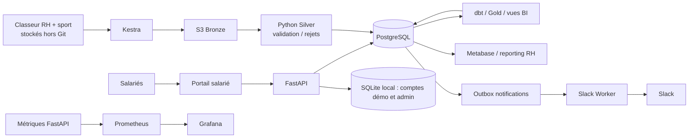

# Architecture technique — SportPulse AI

> Périmètre : preuve de concept et données de démonstration. Pas de versement de prime ni d'attribution automatique de jours.

## Vue d'ensemble

## Flux batch

1. **Préparation** : sources RH et sportives *privées* + activités historiques synthétiques à graine stable ; fichiers source hors Git.
2. **Bronze / S3** : conservation du fichier et empreinte SHA-256 ; manifests traçables.
3. **Silver** : normalisation et contrôle des formats/relations/rejets ; seuil de rejets paramétrable.
4. **PostgreSQL / Gold / dbt** : tables et modèles analytiques, tests d'intégrité, agrégats et vues de reporting.
5. **Scénarios** : comparaison de taux 5 % et 6 % avec version des règles, exécution Kestra, historique exploitable.

## Flux applicatif et diffusion

- Portail salarié et RH servi par **FastAPI**.
- Déclaration persistée avec événement dans une **outbox transactionnelle** (SQLite pour la démo, PostgreSQL pour les activités RH).
- **Slack Worker** consomme les événements, publie après validation de l'opt-in, et prévoit un retry/idempotence.
- Génération de motivation : **Mistral** uniquement si compte API disponible, sinon **template de secours**. Ce flux n'exécute pas de RAG.
- Métabase peut consulter `powerbi.v_activity_monthly` pour agréger les données Gold historiques et déclarations portail.

## Monitoring : portée observée

- Prometheus récupère les métriques HTTP de FastAPI ; Grafana présente disponibilité, débit, erreurs et latence.
- Pour PostgreSQL, Kestra, Docker ou Slack Worker, une instrumentation dédiée reste nécessaire ; ne pas prétendre que toutes ces cibles sont déjà collectées.

## Sécurité et limites

- Les classeurs RH, salaires, bases SQLite, jetons Slack, clés AWS et configurations `.env` ne sont pas versionnés.
- Les copies d'activités destinées à Slack ne contiennent pas de salaire, d'adresse ni de GPS précis.
- Les données sources historiques du POC peuvent être synthétiques et ne constituent pas des preuves RH.
- Kestra utilise le socket Docker : **accès très privilégié**, acceptable uniquement dans un environnement de démonstration isolé. À revoir avant déploiement.
- L'application n'est pas un système de paie et ne déclenche aucun versement automatique.
